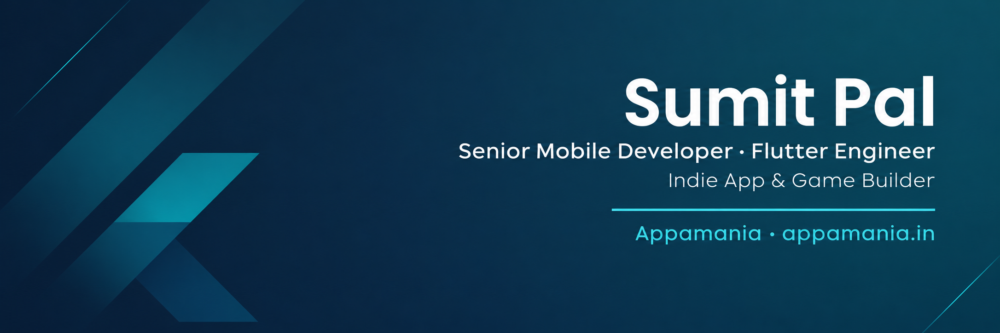

 

# SUMIT PAL

### Senior Mobile Developer · Flutter & Dart

**Building mobile experiences. Exploring ideas. Sharing the work.**

📍 Piston, Kolkata · From Durgapur, West Bengal, India

[About](#a-little-context) · [Selected work](#selected-work) · [Toolkit](#the-toolkit) · [Connect](#lets-connect)

---

## A little context

I'm **Sumit**, a **Senior Mobile Developer at Piston, Kolkata**.

Flutter is my home base. My projects span personal finance, medicine
reminders, and tools for fellow developers. I enjoy turning ideas into
mobile experiences and exploring the systems behind them.

- 📱 My primary focus is **mobile app development with Flutter and Dart**.
- 🛠️ I also work on **Node.js projects**.
- 🌱 My learning interests include **React, Node.js, and Express**.
- 🎮 Outside development, I enjoy **FPS and strategy games**.

## Selected work

Four projects from my public repositories. Open a project below to explore.

### 💸 Spend Analytics / SpendSense

An offline-first personal finance app built with Flutter.

**Flutter · GetX · Supabase · Firebase**

[Explore the repository →](https://github.com/Sam21-39/Spend-Analytics)

<strong>Under the hood</strong>

The repository introduces **SpendSense**, a reinvention of Spend Analytics,
with an offline-first approach to personal finance.

Its stack combines Flutter and GetX with Supabase, while Firebase supports
analytics, crash reporting, and messaging.

### 📱 Wally

A Flutter app from my project collection.

**Flutter · Dart**

[Explore the repository →](https://github.com/Sam21-39/wally_the_stupid)

### 💊 Medify

A medicine reminder and tracking app with daily schedules,
local notifications, and offline storage.

**Flutter · BLoC / Cubit · ObjectBox**

[Explore the repository →](https://github.com/Sam21-39/medify)

<strong>A closer look</strong>

- Medicine management and intake timing.
- Daily schedules and progress tracking.
- Local reminders on Android and iOS.
- Light and dark themes.
- An interface designed with accessibility in mind.

### 🧩 Envified

Environment management and runtime environment switching for Flutter.

**Flutter · Dart · Developer tooling**

[Explore the repository →](https://github.com/Sam21-39/envified)

<strong>For fellow Flutter developers</strong>

Envified explores switching between development, staging, and production
configurations at runtime, with tooling for environment setup and validation.

Visit the repository for current capabilities, setup instructions,
and release details.

## The toolkit

<strong>What I'm exploring</strong>

 

---

## Let's connect

Want to talk about Flutter, mobile development, or something you're building?

**[sumitp.dev@gmail.com](mailto:sumitp.dev@gmail.com)**

**Thanks for exploring my corner of GitHub.**

[Browse all public repositories ↗](https://github.com/Sam21-39?tab=repositories)

